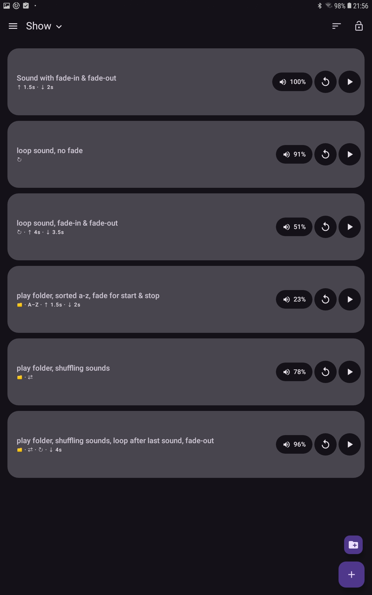
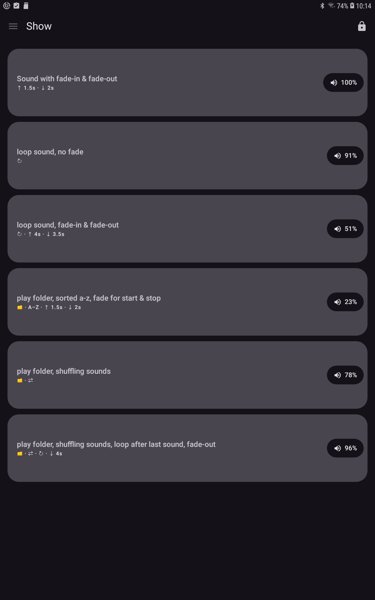
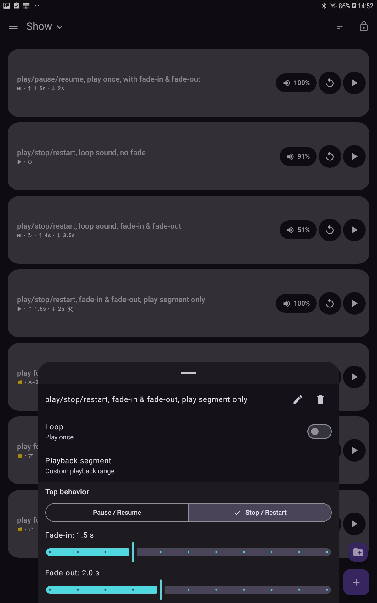
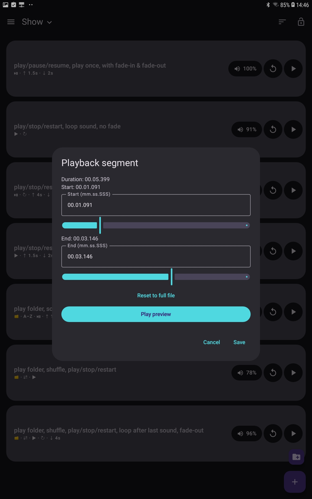
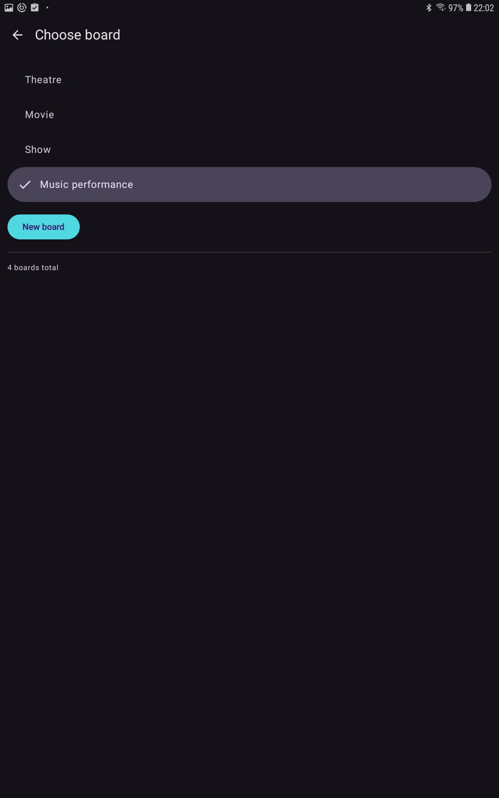
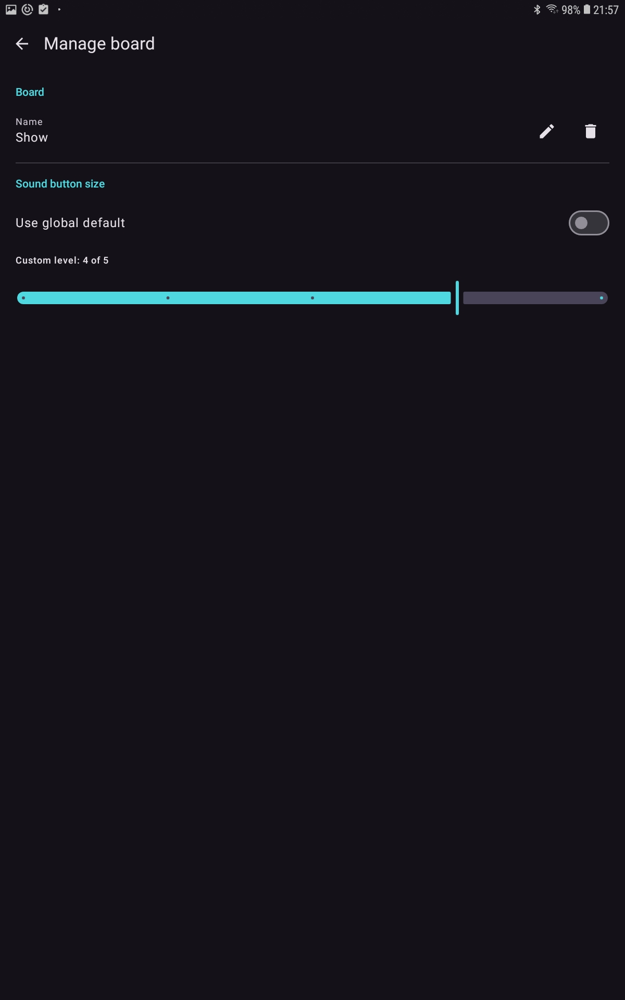
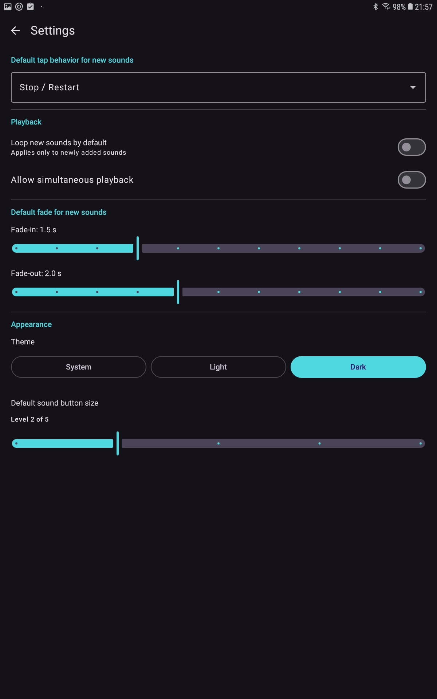
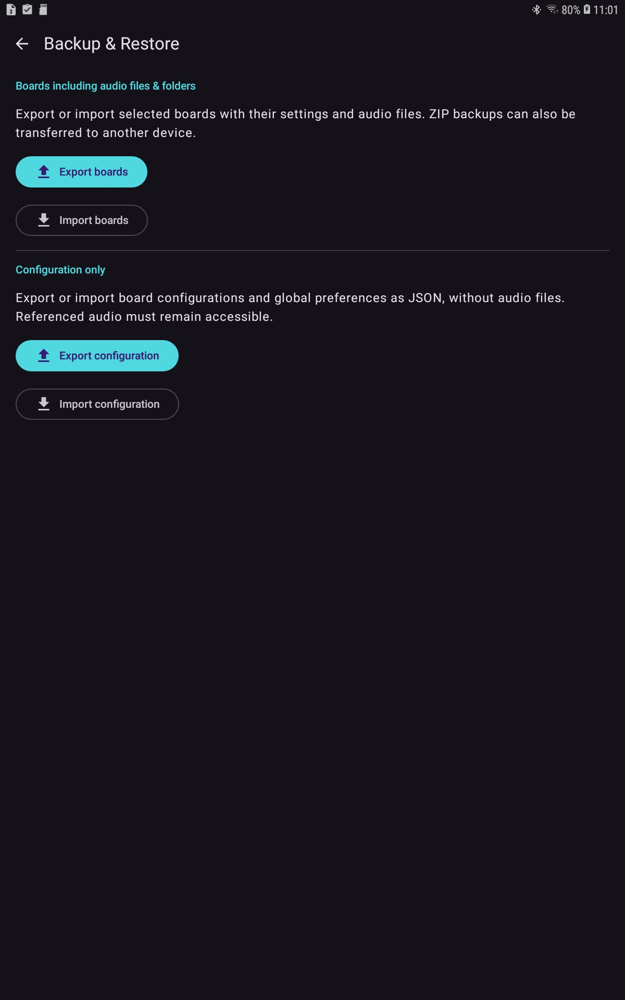

# Soundboard NG

An offline Android soundboard for theatre, live performances and events.

Designed for reliable audio cue playback, with flexible sound configuration and a simplified interface for use during live performances.

## Features

- Multiple soundboards with configurable sound button sizes
- Play, pause, restart and per-sound configurable tap behaviour (Pause/Resume or Stop/Restart), with status indicators
- Independent sound volume and per-sound fade-in/fade-out
- Per-sound playback segments with precise start/end timestamps, preview and looping
- Looping and optional simultaneous playback
- Play individual audio files or entire folders
- Folder playback in alphabetical or shuffled order
- Shuffle without repetition until every file has played once
- Performance lock mode with immediate touch response
- Selective export and import of one, several or all soundboards
- Portable ZIP backups containing soundboard configuration and associated audio files
- JSON configuration export and import without copying audio files
- Add imported boards to the existing configuration or replace the configuration
- Light, dark and system appearance
- Notification permission status and shortcut to Android settings (Android 13+)

## Screenshots

### Soundboard

|                                                                 Edit mode                                                                  |                                                                   Performance lock mode                                                                    |
|:------------------------------------------------------------------------------------------------------------------------------------------:|:----------------------------------------------------------------------------------------------------------------------------------------------------------:|
| <a href="docs/screenshots/soundboard-edit.jpg"></a> | <a href="docs/screenshots/soundboard-locked.jpg"></a> |

### Playback segment configuration

|                                                                         Sound options (long press)                                                                          |                                                                                  Playback segment                                                                                   |
|:---------------------------------------------------------------------------------------------------------------------------------------------------------------------------:|:-----------------------------------------------------------------------------------------------------------------------------------------------------------------------------------:|
| <a href="docs/screenshots/sound-longpress-menu.jpg"></a> | <a href="docs/screenshots/playback-segment.jpg"></a> |

### Configuration and management

|                                                           Board selection                                                           |                                                             Board management                                                             |
|:-----------------------------------------------------------------------------------------------------------------------------------:|:----------------------------------------------------------------------------------------------------------------------------------------:|
| <a href="docs/screenshots/board-selector.jpg"></a> | <a href="docs/screenshots/board-management.jpg"></a> |

|                                                           Settings                                                           |                                                           Backup and restore                                                           |
|:----------------------------------------------------------------------------------------------------------------------------:|:--------------------------------------------------------------------------------------------------------------------------------------:|
| <a href="docs/screenshots/settings.jpg"></a> | <a href="docs/screenshots/backup-restore.jpg"></a> |

Click any screenshot to view it at full resolution.

## Performance lock mode

Performance lock mode simplifies operation during live shows:

- The entire sound row becomes a playback control.
- Playback responds immediately when the screen is touched.
- Short taps and long presses each trigger exactly one playback action.
- Subsequent touches control playback according to the configured tap behaviour.
- Separate restart and play/pause buttons are hidden.
- Volume and playback status indicators remain visible.
- Editing and configuration controls are disabled.

Configure sounds before the performance, then enable lock mode for straightforward operation during the show.

## Folder playback

In addition to individual audio files, Soundboard NG supports playing entire folders.

- **Alphabetical:** Play files in filename order.
- **Shuffle:** Play every file once in random order before repeating.
- **Loop:** Optionally repeat folder playback cycles.

## Playback segments

Individual audio files can be configured to play only a selected portion instead of the entire recording.

- Open a sound's options and select **Playback segment**.
- Set the start and end positions using the sliders or precise timestamps in `mm.ss.SSS` format.
- Leave the end position empty to play until the end of the file.
- Use **Preview** to audition the selected segment before saving.
- Use **Reset** to restore playback of the complete file.
- Looping repeats the selected segment rather than the complete recording.
- Fade-in and fade-out also apply to playback segments.

Segment settings are stored with the soundboard and preserved in backups. Existing soundboards continue to play complete files by default.

**Known issue:** On some devices, dragging a slider directly from its rightmost position may not respond immediately. Tap elsewhere on the slider first, or use the precise timestamp fields instead.

## Backup and restore

Soundboard NG provides two complementary ways to export and import soundboards:

- **Boards including audio files & folders:** Portable ZIP backups containing the selected soundboards and their associated audio data.
- **Configuration only:** JSON files containing soundboard configuration and audio references, without copying the audio files.

Both formats support selecting individual soundboards rather than always exporting or importing the complete configuration.

### ZIP – Boards including audio files & folders

Use ZIP backups to transfer soundboards together with their audio content or to restore a previous configuration.

**Export boards**

1. Open **Backup and restore** and select **Export boards**.
2. Choose one, several or all soundboards. All boards are selected by default.
3. Export the selected boards to a ZIP file.

The backup contains the selected soundboards and the associated audio files and folder content.

**Import boards**

1. Select **Import boards** and choose a ZIP backup.
2. Inspect the available soundboards and select which ones to import.
3. Choose an import mode:
  - **ADD:** Import the selected boards alongside existing boards.
  - **REPLACE:** Replace the existing soundboard configuration with the selected imported boards.
4. Confirm the import. REPLACE requires explicit confirmation.

ADD is the default mode. Existing boards remain available, and imported boards receive unique identifiers and adjusted names where necessary.

ZIP import can restore audio into the app's internal storage or a selected local storage folder. The internal app storage is the default destination. External storage destinations must be local and available offline.

### JSON – Configuration only

JSON export and import are useful for transferring board layouts and settings without duplicating audio files.

**Export configuration**

1. Select **Export configuration**.
2. Choose one, several or all soundboards. All boards are selected by default.
3. Save the JSON file.

The JSON file contains the selected boards, sound settings, playback segments and audio references.

**Audio files and folder contents are not included.**

**Import configuration**

1. Select **Import configuration** and choose a JSON file.
2. Review the soundboards contained in the file.
3. Select one, several or all boards to import.
4. Choose **ADD** or **REPLACE**.
5. Confirm the import. REPLACE requires explicit confirmation.

ADD preserves existing soundboards, the active board and existing global settings. Imported boards are added with unique identifiers and adjusted names if necessary.

REPLACE replaces the existing soundboards with the selected imported boards and adopts the imported global settings.

Because JSON files contain only references to audio files and folders, those resources must remain accessible on the device. A JSON file alone cannot restore missing audio data or grant access to files on another device.

Soundboard NG checks audio references during JSON import and warns about unavailable files or folders. The import can still proceed, preserving the affected sound tiles and their settings.

### Import safety

Before a JSON or ZIP import changes the stored configuration, Soundboard NG saves the previous configuration to an internal recovery file:

`soundboard-before-import.json`

This file is stored in the app's private storage and is not automatically exported or presented as a user-facing restore option.

The configuration update is performed as a single DataStore transaction.

The recovery file is replaced by a subsequent import, so it should not be considered a substitute for a separately saved ZIP backup.

**Recommendation:** Before using REPLACE or making substantial changes, export a complete ZIP backup and keep it in a safe location.

## Privacy and cost

**Free of charge. No advertising. No tracking. No account.**

Soundboard NG works offline and does not require network access.

## Requirements

Android 8.0 (API 26) or later.

## Install

Releases are available at [GitHub Releases](https://github.com/lattemacchiato/soundboard/releases).

Submission to the official F-Droid catalog is planned.

## Development

```bash
git clone https://github.com/lattemacchiato/soundboard.git
cd soundboard
./gradlew :app:testDebugUnitTest :app:assembleDebug
```

## Credits and license

Soundboard NG is a modified fork of [Soundboard by 508.dev](https://github.com/508-dev/soundboard).

Original copyright and license notices remain applicable.

Licensed under **GNU GPL-3.0**; see [LICENSE](LICENSE).
