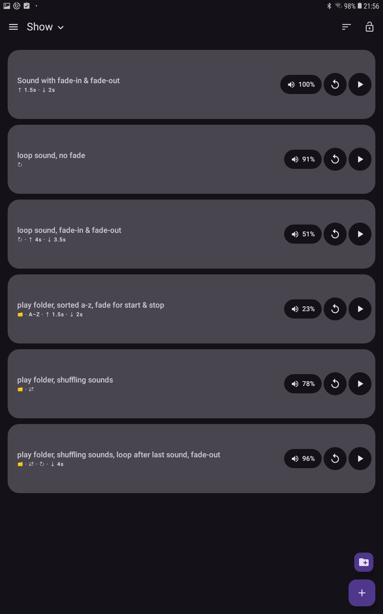
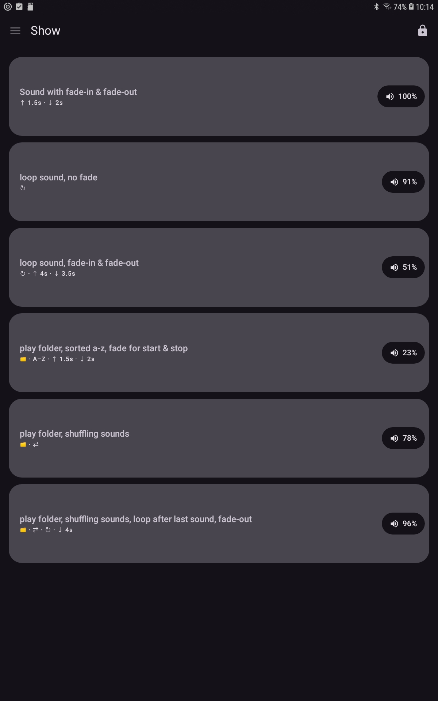
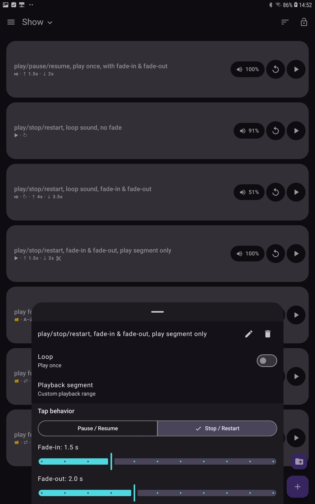
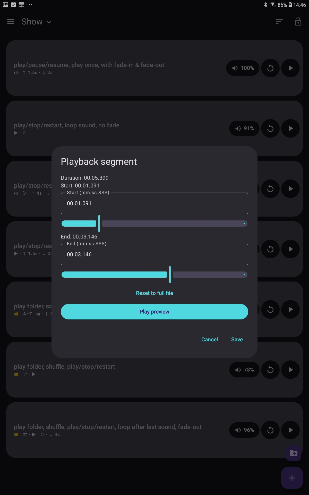
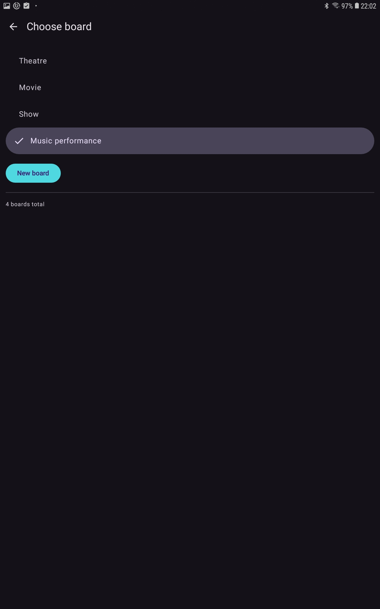
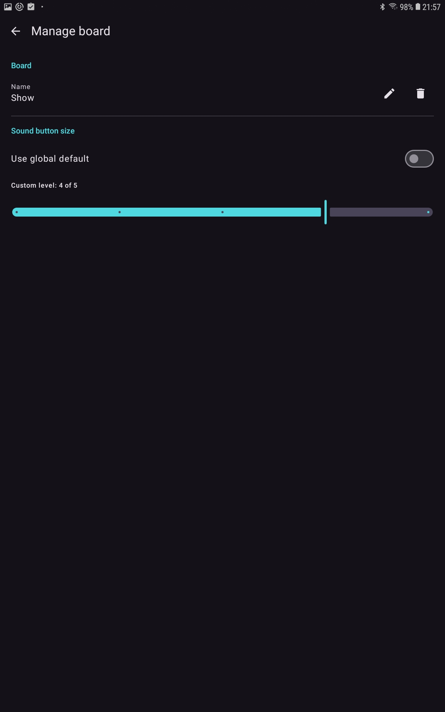
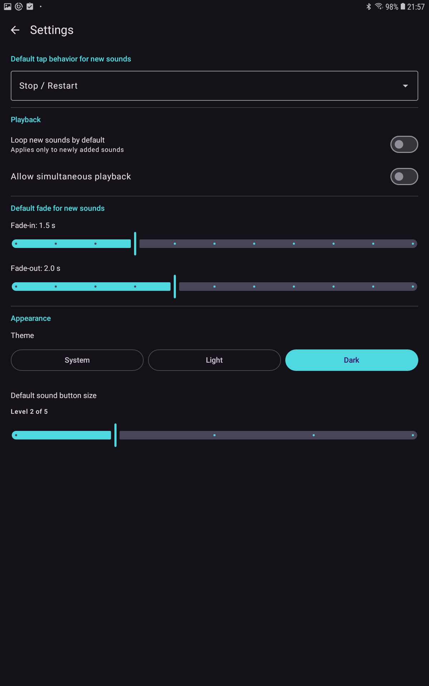
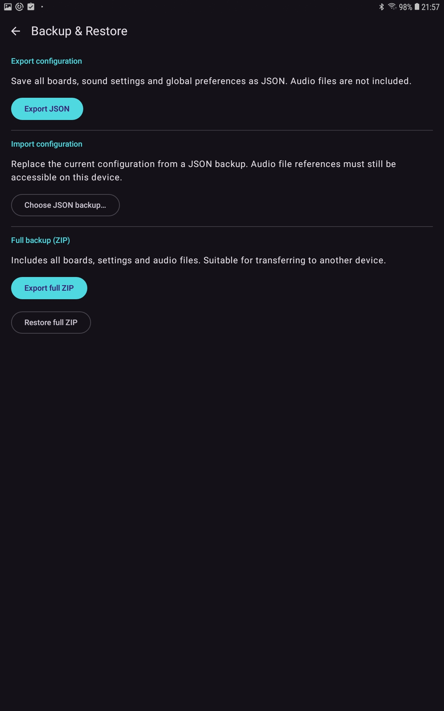

# Soundboard NG

An offline Android soundboard for theatre, live performances and events.

Designed for reliable audio cue playback, with flexible sound configuration
and a simplified interface for use during live performances.

## Features

- Multiple soundboards with configurable sound button sizes
- Play, pause, restart and per-sound configurable tap behaviour (Pause/Resume or Stop/Restart), with status indicators
- Independent sound volume and per-sound fade-in/fade-out
- Per-sound playback segments with precise start/end timestamps, preview and looping
- Looping and optional simultaneous playback
- Play individual audio files or entire folders
- Folder playback in alphabetical or shuffled order
- Shuffle without repetition until every file has played once
- Performance lock mode with immediate touch response
- JSON configuration export and portable ZIP backups with audio
- Light, dark and system appearance
- Notification permission status and shortcut to Android settings (Android 13+)

## Screenshots

### Soundboard

|                                                                 Edit mode                                                                  |                                                                   Performance lock mode                                                                    |
|:------------------------------------------------------------------------------------------------------------------------------------------:|:----------------------------------------------------------------------------------------------------------------------------------------------------------:|
| <a href="docs/screenshots/soundboard-edit.jpg"></a> | <a href="docs/screenshots/soundboard-locked.jpg"></a> |

### Playback segment configuration

|                                                                         Sound options (long press)                                                                          |                                                                                  Playback segment                                                                                   |
|:---------------------------------------------------------------------------------------------------------------------------------------------------------------------------:|:-----------------------------------------------------------------------------------------------------------------------------------------------------------------------------------:|
| <a href="docs/screenshots/sound-longpress-menu.jpg"></a> | <a href="docs/screenshots/playback-segment.jpg"></a> |

### Configuration and management

|                                                           Board selection                                                           |                                                             Board management                                                             |
|:-----------------------------------------------------------------------------------------------------------------------------------:|:----------------------------------------------------------------------------------------------------------------------------------------:|
| <a href="docs/screenshots/board-selector.jpg"></a> | <a href="docs/screenshots/board-management.jpg"></a> |

|                                                           Settings                                                           |                                                           Backup and restore                                                           |
|:----------------------------------------------------------------------------------------------------------------------------:|:--------------------------------------------------------------------------------------------------------------------------------------:|
| <a href="docs/screenshots/settings.jpg"></a> | <a href="docs/screenshots/backup-restore.jpg"></a> |

Click any screenshot to view it at full resolution.

## Performance lock mode

Performance lock mode simplifies operation during live shows:

- The entire sound row becomes a playback control.
- Playback responds immediately when the screen is touched.
- Short taps and long presses each trigger exactly one playback action.
- Subsequent touches control playback according to the configured tap behaviour.
- Separate restart and play/pause buttons are hidden.
- Volume and playback status indicators remain visible.
- Editing and configuration controls are disabled.

Configure sounds before the performance, then enable lock mode for straightforward
operation during the show.

## Folder playback

In addition to individual audio files, Soundboard NG supports playing entire folders.

- **Alphabetical:** Play files in filename order.
- **Shuffle:** Play every file once in random order before repeating.
- **Loop:** Optionally repeat folder playback cycles.

## Playback segments

Individual audio files can be configured to play only a selected portion
instead of the entire recording.

- Open a sound's options and select **Playback segment**.
- Set the start and end positions using the sliders or precise timestamps
  in `mm.ss.SSS` format.
- Leave the end position empty to play until the end of the file.
- Use **Preview** to audition the selected segment before saving.
- Use **Reset** to restore playback of the complete file.
- Looping repeats the selected segment rather than the complete recording.
- Fade-in and fade-out also apply to playback segments.

Segment settings are stored with the soundboard and preserved in backups.
Existing soundboards continue to play complete files by default.

**Known issue:** On some devices, dragging a slider directly from its
rightmost position may not respond immediately. Tap elsewhere on the slider
first, or use the precise timestamp fields instead.

## Privacy and cost

**Free of charge. No advertising. No tracking. No account.**

Soundboard NG works offline and does not require network access.

## Requirements

Android 8.0 (API 26) or later.

## Install

Releases are available at
[GitHub Releases](https://github.com/lattemacchiato/soundboard/releases).

Submission to the official F-Droid catalog is planned.

## Development

```bash
git clone https://github.com/lattemacchiato/soundboard.git
cd soundboard
./gradlew :app:testDebugUnitTest :app:assembleDebug
```

## Credits and license

Soundboard NG is a modified fork of
[Soundboard by 508.dev](https://github.com/508-dev/soundboard).

Original copyright and license notices remain applicable.

Licensed under **GNU GPL-3.0**; see [LICENSE](LICENSE).
